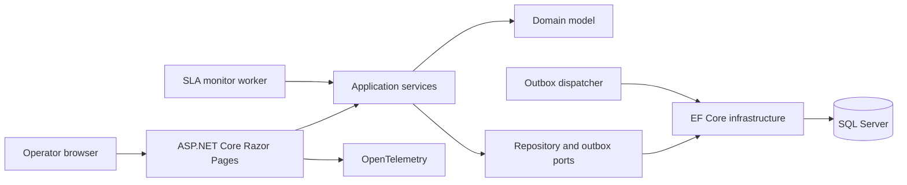

# OpsGuardian

OpsGuardian is a full-stack incident and SLA management application built with .NET 10. It demonstrates how I design maintainable business software: domain rules stay isolated, writes are paired with transactional outbox messages, background workers monitor operational risk, and the web experience remains clear under pressure.

This is an original, clean-room portfolio project. It does not contain employer source code, data, credentials, or proprietary business rules.

## What it demonstrates

- ASP.NET Core 10 Razor Pages with a responsive, accessible operations dashboard
- Domain-driven incident lifecycle and severity-based SLA policies
- EF Core with SQL Server in development and production
- Transactional outbox persistence for reliable integration boundaries
- Background workers for SLA monitoring and outbox dispatch
- OpenID Connect outside development and role-based authorization
- Antiforgery protection, rate limiting, HSTS, CSP and security headers
- OpenTelemetry traces and metrics with optional OTLP export
- Liveness and database readiness health checks
- Unit and web integration tests using an isolated SQLite database
- Central package management, locked dependencies and vulnerability auditing

## Architecture



| Project | Responsibility |
| --- | --- |
| `OpsGuardian.Domain` | Incident aggregate, lifecycle invariants and SLA policy |
| `OpsGuardian.Application` | Use cases, ports, dashboard projections and outbox coordination |
| `OpsGuardian.Infrastructure` | EF Core persistence, SQL Server, health checks and workers |
| `OpsGuardian.Web` | Razor Pages UI, authentication, authorization and observability |
| `OpsGuardian.Domain.Tests` | Fast domain rule coverage |
| `OpsGuardian.Web.Tests` | End-to-end application behavior through `WebApplicationFactory` |

More detail is available in [the architecture decision record](docs/architecture.md).

## Run locally

### Prerequisites

- .NET SDK 10.0.403 or a compatible 10.0 feature band
- SQL Server LocalDB, included with common Visual Studio installations on Windows

### Start the application

```powershell
dotnet restore OpsGuardian.slnx --locked-mode
dotnet run --project src/OpsGuardian.Web
```

The Development profile uses a local-only LocalDB database, creates the development schema, adds synthetic demo incidents, and signs in a `Demo Operator`. These conveniences are disabled outside Development.

No credentials belong in tracked settings. For a different local SQL Server, use user-secrets:

```powershell
dotnet user-secrets init --project src/OpsGuardian.Web
dotnet user-secrets set --project src/OpsGuardian.Web "ConnectionStrings:OpsGuardian" "<your-local-connection-string>"
```

### Verify the solution

```powershell
dotnet build OpsGuardian.slnx -c Release --no-restore
dotnet test OpsGuardian.slnx -c Release --no-build
dotnet format OpsGuardian.slnx --verify-no-changes --no-restore
dotnet list OpsGuardian.slnx package --vulnerable --include-transitive
```

## Operational endpoints

- `GET /health/live` — process liveness
- `GET /health/ready` — SQL database connectivity

Set `OTEL_EXPORTER_OTLP_ENDPOINT` to enable OTLP trace and metric export. Without it, instrumentation remains registered but no external exporter is activated.

## Production configuration

Production intentionally fails closed unless these values are supplied through a secure configuration provider:

- `ConnectionStrings__OpsGuardian`
- `Authentication__OpenIdConnect__Authority`
- `Authentication__OpenIdConnect__ClientId`
- `Authentication__OpenIdConnect__ClientSecret`, when required by the identity provider

Database schema changes should be generated, reviewed and applied by the deployment pipeline for the target environment. The application never auto-creates or migrates a production database.

## Container image

Build the application image locally:

```powershell
docker build -t opsguardian:local .
```

The image runs as the platform-provided non-root user. Supply production configuration at runtime; the image contains no secrets or environment-specific connection strings.

## License

This project is available under the [MIT License](LICENSE).
